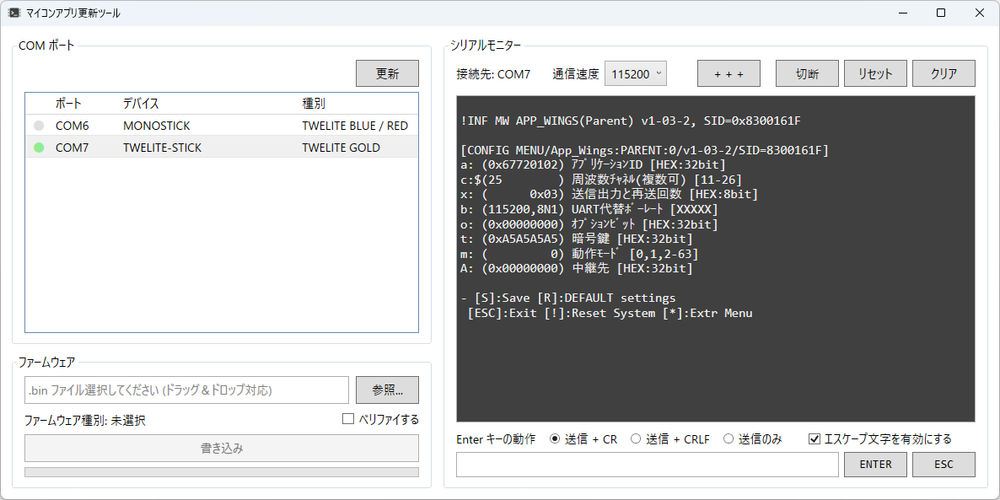

# マイコンアプリ更新ツール

## これはなに？

TWELITE のアプリを更新するためのシンプルなアプリケーションです。

200 KB 以下のシングルバイナリ 1つ で動作します。

### 動作環境

- Windows 10 / 11
- .NET Framework 4.8

### 対応マイコン

- TWELITE BLUE / RED / GOLD
  - FTDI D2XX ドライバが必要です。通常は Windows Update で自動的にインストールされます。

## GUI イメージ



### COM ポート

- シリアルポートの一覧が表示されます。
- ダブルクリックするとシリアルモニターが接続状態になります。

### ファームウェア

- ファームウェアを選択し、書き込みボタンを押すと、選択した COM ポート経由で書き込みが実行されます。
- ポートとファームウェア種別が一致していない時には書き込みできないようになっています。

### シリアルモニター

- 複数の通信速度に対応したシリアルモニターです。
- 殆どのエスケープシーケンスは無視されます。
- 「+ + +」 ボタンは、TWELITE の標準アプリでインタラクティブモードへの移行を簡単に実行するためものです。
- 「ESC」 ボタンを押すと ESC コード `\x1B` が送信されます。

## コマンドライン

```
マイコンアプリ更新ツール.exe write --firmware <ファイル> [--port <COMn>] [--verify] [--monitor <秒>]
マイコンアプリ更新ツール.exe reset [--port <COMn>] [--monitor <秒>]
```

- `reset` は書き込みをせずにマイコンをリセットして、`--monitor` で指定した秒数だけシリアル出力を受信します。`--port` を省略した場合は、ポートが 1つ だけの時に、そのポートを使用します。

- ファームウェアを書き込んだ後、マイコンを再起動して、`--monitor` で指定した秒数だけシリアル出力を受信します。
- 受信したシリアル出力は標準出力に、書き込みの経過とエラーは標準エラー出力に出力されます。
- `--port` を省略した場合は、ポートが 1つ だけの時に、そのポートを使用します。
- `--verify` を指定すると、書き込み後にベリファイを実行します。
- 終了コード: 0 = 成功、1 = 失敗、2 = 引数の誤り

## 現状について

このアプリのコードは、大部分が AI によって記述されています。基本的な動作は確認していますが、構造は整理されておらず、コードは読みづらく、異常処理は統一されていません。「とりあえず動く」という状態です。

不具合等を見つけた場合には Issue を作成してください。
